<h3><code>flexxy-07@github ~ $ whoami</code></h3>

<table>
  <tr>
    <td valign="middle"></td>
    <td valign="middle"></td>
  </tr>
</table>

<strong>AI Engineer in the Making · LLM Applications · Agentic Systems</strong>

Building and exploring AI-powered applications, with a focus on <strong>LLM systems, agentic workflows, long-term memory, and evaluation</strong>. I enjoy going beyond API calls to understand how these systems work under the hood.

---

### <code>flexxy-07@github ~ $ cat about.txt</code>

- 🎓 Computer Science undergraduate at KIET Group of Institutions
- 🤖 Focused on AI engineering and practical LLM-powered systems
- 🧩 Exploring LangGraph, agent orchestration, memory systems, semantic search, and LLM evaluation
- 🐍 Using Python for AI/ML and backend development
- ⚙️ Building APIs and data layers with FastAPI, PostgreSQL, pgvector, and Docker
- 🌱 Interested in reliable AI systems: evaluation, guardrails, observability, and responsible tool execution
- 📫 [Email](mailto:sumitrpt007@gmail.com)

### <code>flexxy-07@github ~ $ ls ./projects</code>

<table>
  <tr>
    <td width="50%" valign="top">
      <h3><a href="https://github.com/flexxy-07/RecoverX">RecoverX</a></h3>
      
An AI-powered payment recovery agent built around a multi-step LangGraph workflow. The LLM diagnoses payment failures, while deterministic policies and guardrails control recovery actions.

      
<strong>Focus:</strong> Agentic workflows · Human review · Guardrails · Tool/API execution

      
<strong>Stack:</strong> LangGraph · Google GenAI · Python · React · Firestore

    </td>
    <td width="50%" valign="top">
      <h3><a href="https://github.com/flexxy-07/Mem-CLI">MemCLI</a></h3>
      
A persistent memory system for AI agents, exploring semantic retrieval, memory extraction, deduplication, contradiction handling, and short-term versus long-term memory.

      
<strong>Focus:</strong> Agent memory · Vector search · Memory lifecycle · Data governance

      
<strong>Stack:</strong> LangGraph · Gemini · PostgreSQL · pgvector · SQLAlchemy

    </td>
  </tr>
  <tr>
    <td width="50%" valign="top">
      <h3><a href="https://github.com/flexxy-07/ShinkaAI">ShinkaAI</a></h3>
      
An AI search application that combines web search with LLM-generated answers, source ranking, and streamed responses.

      
<strong>Focus:</strong> AI search · Source relevance · Streaming responses

      
<strong>Stack:</strong> FastAPI · Gemini · Tavily · Sentence Transformers · WebSockets · Flutter

    </td>
    <td width="50%" valign="top">
      <h3><a href="https://github.com/flexxy-07/mini-llm-evaluation">Mini LLM Evaluation Harness</a></h3>
      
A lightweight framework for comparing language models on a sentiment classification task using accuracy, latency, and token usage.

      
<strong>Focus:</strong> LLM evaluation · Benchmarking · Model comparison

      
<strong>Stack:</strong> Python · LLMs · CSV

    </td>
  </tr>
  <tr>
    <td width="50%" valign="top">
      <h3><a href="https://github.com/flexxy-07/learning-resume-bot">AI Resume Chat</a></h3>
      
A full-stack conversational application with a React frontend and a FastAPI/LangGraph backend that streams AI responses.

      
<strong>Focus:</strong> LLM-powered chat · Backend orchestration · Streaming

      
<strong>Stack:</strong> React · FastAPI · LangGraph · Python

    </td>
    <td width="50%" valign="top">
      <h3><a href="https://github.com/flexxy-07/LapPriceAI">LapPriceAI</a></h3>
      
An end-to-end machine learning project that predicts laptop prices from hardware specifications, covering preprocessing, feature engineering, model training, and API integration.

      
<strong>Focus:</strong> Applied ML · Regression · Feature engineering

      
<strong>Stack:</strong> Python · Pandas · NumPy · Scikit-learn · FastAPI

    </td>
  </tr>
</table>

### <code>flexxy-07@github ~ $ ./toolkit.sh</code>

**AI / Machine Learning**

  
  
  
  
  

**Backend · Data · Infrastructure**

**Application Development**

### <code>flexxy-07@github ~ $ ./contributions.sh</code>

Personal GitHub contribution activity · automatically refreshed daily at 02:00 UTC (07:30 IST)

### <code>flexxy-07@github ~ $ ./connect.sh</code>

  
  
  

Building, breaking, evaluating, and learning — one experiment at a time.

